# AdaPath-NPU — Score-Margin 기반 난이도 적응형 Tiny NPU Datapath

경북대학교 IDEC 2026 창의 회로설계 챌린지 (디지털) · 팀 **Pin_Pineapple_Applepen(PPA)**
이화여자대학교 전자전기공학과 윤현서 · 최서현 · 윤홍은 (지도교수 최종윤)

Early Classifier 점수의 Top-1 − Top-2 차이(Score Margin)로 입력 난이도를 판정해
Easy / Medium / Hard 경로를 선택하는 NPU 데이터패스. ASAP7 7nm(OpenROAD-flow-scripts)로
주최 측 레퍼런스 가속기와 PPA를 비교한다.

| 과제 | 모델 / 데이터 | 내용 |
|---|---|---|
| 지정주제 | 모델 A (주 경로: conv1 3ch, conv2 3ch, FC 48→10), MNIST | 레퍼런스와 같은 주 경로 구조에 Early Classifier 및 AdaPath 적용 |
| 자유주제 | 모델 B (conv2 8ch), WM-811K 4-class | 적용 전·후 PPA |
| 확장 | 모델 B, MNIST | Medium 경로 효과 분석 |

## 결과보고서

📄 **[최종 결과보고서 PDF · 44페이지](report/결과보고서_PPA.pdf)** — 2026-11-11 제공받은 최종본으로 갱신했습니다.

기존 제출 ZIP에는 이전 보고서가 포함되어 있습니다. 최신 보고서는 위 PDF 링크에서 확인하세요.

[기존 Word 작업본](report/결과보고서_PPA.docx)과 [기존 생성 코드](report/make_final_report.py)는 이전 작업 자료이며, 위 최종 PDF와 내용이 일치하지 않을 수 있습니다. 아래 요약은 최종 PDF를 기준으로 합니다.

## 주요 결과 (지정주제: 주최 측 Reference 대비 AdaPath_A)

| 지표 | Reference | **AdaPath_A** | 변화 |
|---|---:|---:|---:|
| 정답 (주최 측 입력 순차 1,000회) | 970 | **970** | 유지 |
| 평균 처리 cycle / 추론 | 1,334 | **851.8** | 36.1 % 감소 |
| 추정 Fmax (pre-layout, 클럭 주기 스윕) | 569.8 MHz | 543.1 MHz | 4.7 % 감소 |
| 추론 지연 @Fmax | 2,341 ns | **1,569 ns** | 33.0 % 감소 |
| 추론당 에너지 (배치 전 게이트레벨 VCD 기반 추정) | 17.7 nJ | **16.2 nJ** | 8.9 % 감소 |
| Cell Area (ASAP7) | 32,085 µm² | 49,858 µm² | 55.4 % 증가 |
| 평균 실행 MAC / 추론 | 58,080 | **44,275** | 23.8 % 감소 |
| 등가 TOPS/W (Reference MAC 기준) | 6.55 | **7.19** | 9.8 % 증가 |

주최 측 입력은 고유 이미지 100장을 10회 반복한 구성입니다. Reference와 AdaPath_A는 주 경로 구조가 같지만 가중치와 양자화 조건이 다르고 Early Classifier가 추가되어, 위 차이 전체를 경로 선택만의 효과로 해석하지 않습니다. 등가 TOPS/W는 같은 Reference MAC을 분자로 사용하며, 실제 실행 MAC 기준 실효 TOPS/W는 Reference 6.55, AdaPath_A 5.48입니다(보고서 3.7절).

- 배치 전 STA 조건에서 AdaPath_A 543.1 MHz는 판단 회로 없는 Baseline_A 543.3 MHz와 유사합니다. 배치·전역 배선 후 Reference 대비 추론 지연은 2,321 → 1,672 ns로 28.0 % 감소했습니다(보고서 3.6절).
- 자유주제 WM-811K: RTL의 판정·모드·Score Margin이 정수 Golden과 **954 / 954 일치**, Easy / Medium / Hard = 404 / 167 / 383입니다. 분류 정답 수는 AdaPath 774 / 954, 항상 Hard 777 / 954이며, Golden 일치율과 분류 정확도는 다른 지표입니다.
- WM-811K 동일 입력 비교: 모드별 4장씩 총 12장의 배치 전 전력을 평가하고, 두 설계에 같은 RTL 모드 비율을 가중하면 **28.79 → 26.86 nJ/장, 6.70 % 감소**입니다. 기존 8.8 %는 서로 다른 입력을 기준으로 한 값으로, 최종 보고서에서는 동일 입력 비교로 갱신했습니다. 954장 전체의 전력 측정 결과는 아닙니다(보고서 3.9절, 표 25).
- 제출용 Vivado 프로젝트: [vivado/submit/](vivado/submit/) (A: 지정주제, B: 확장, WM: 자유주제)

## 주요 그래프

### 구조와 설계 흐름
| 데이터·제어 흐름 | 설계·평가 흐름 |
|---|---|
| 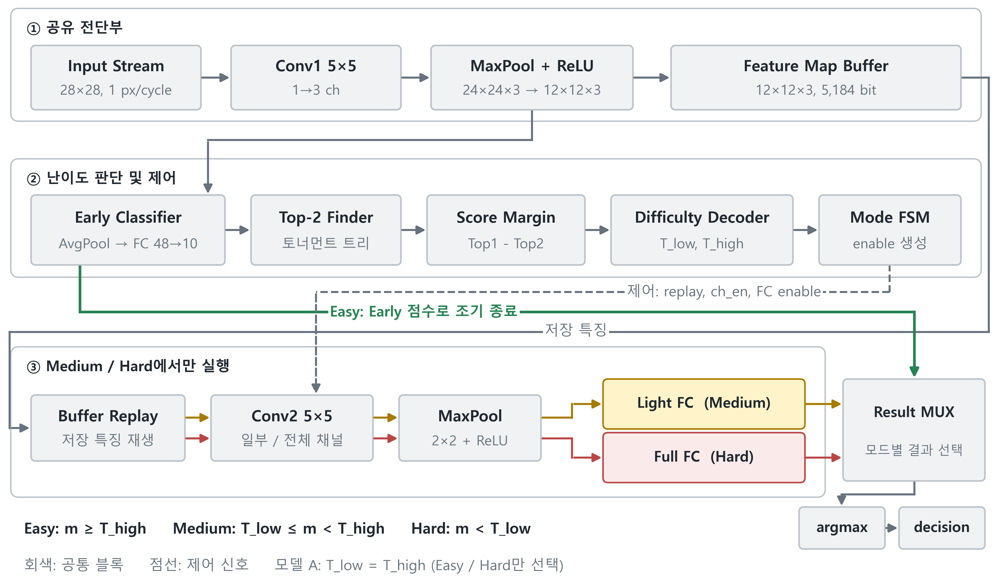 | 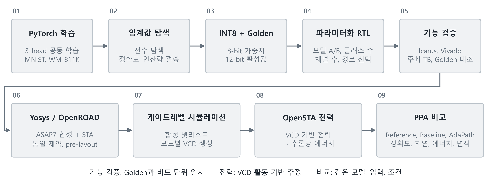 |

**Top-2 Finder 개선** — 직렬 비교 체인 18단 → 이진 토너먼트 트리 4레벨 (판단 회로 임계 경로 약 4배 단축)

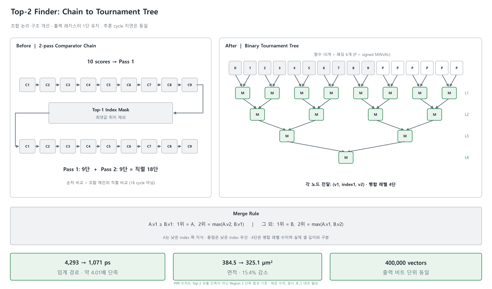

### Reference 대비 PPA (정확도 동일 조건)
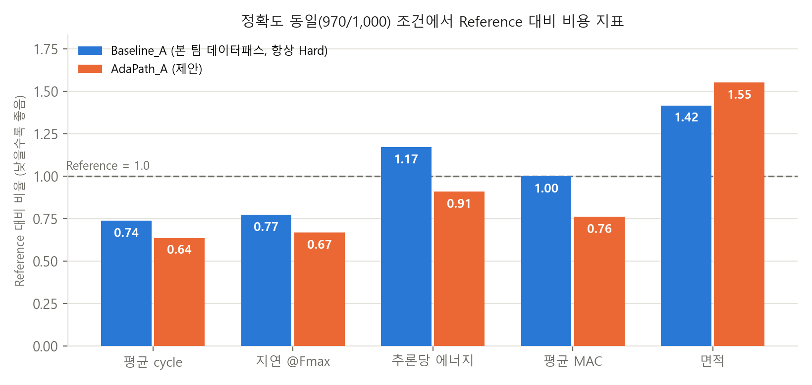

### 에너지는 어디서 쓰이는가 — 블록별 추론당 에너지
Easy에서도 후단부 레지스터가 클럭만 받으며 3.65 nJ를 소모합니다. 아래 그림의 평균 12.7 nJ(Reference 대비 28.7 % 감소)는 게이팅 오버헤드를 제외한 이상적 상한 추정입니다.

**전용 ICG 적용 평가**에서는 같은 팬아웃 제한 버퍼 클럭 트리를 적용한 AdaPath_A끼리 비교했습니다(ASAP7 RVT TT, 100 MHz, 배치 전 VCD 기반 추정). Easy 36장·9구간 평균은 **22.50 → 16.68 nJ/장, 25.9 % 감소**, Hard 4장·1구간은 **30.01 → 23.79 nJ/장, 20.7 % 감소**입니다. Reference 대비 8.9 %와는 비교 기준이 달라 감소율을 합산하지 않습니다(보고서 3.7절).

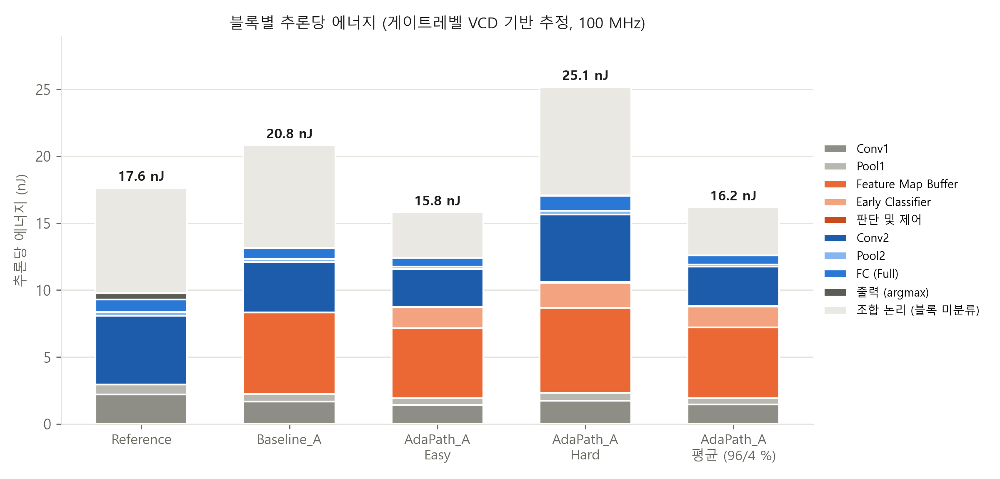

### 에너지 손익분기점 — 모드별 에너지 고정 모델
보고서의 혼합 모델에서는 Easy 비율 약 79.1 %에서 Reference 대비, 약 46.5 %에서 Baseline_A 대비 에너지 손익분기점이 나타납니다. 이는 모드별 에너지를 고정한 계산 결과입니다.
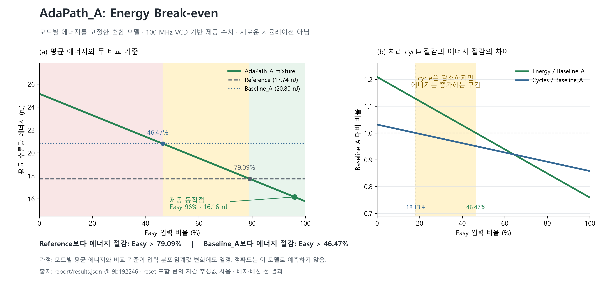

### Vivado 2023.1 실행 (주최 측 top_tb_1000)
같은 41,500 cycle 동안 Reference 30장 vs AdaPath_A 47장 완료 (논리 시뮬레이션 시간축)

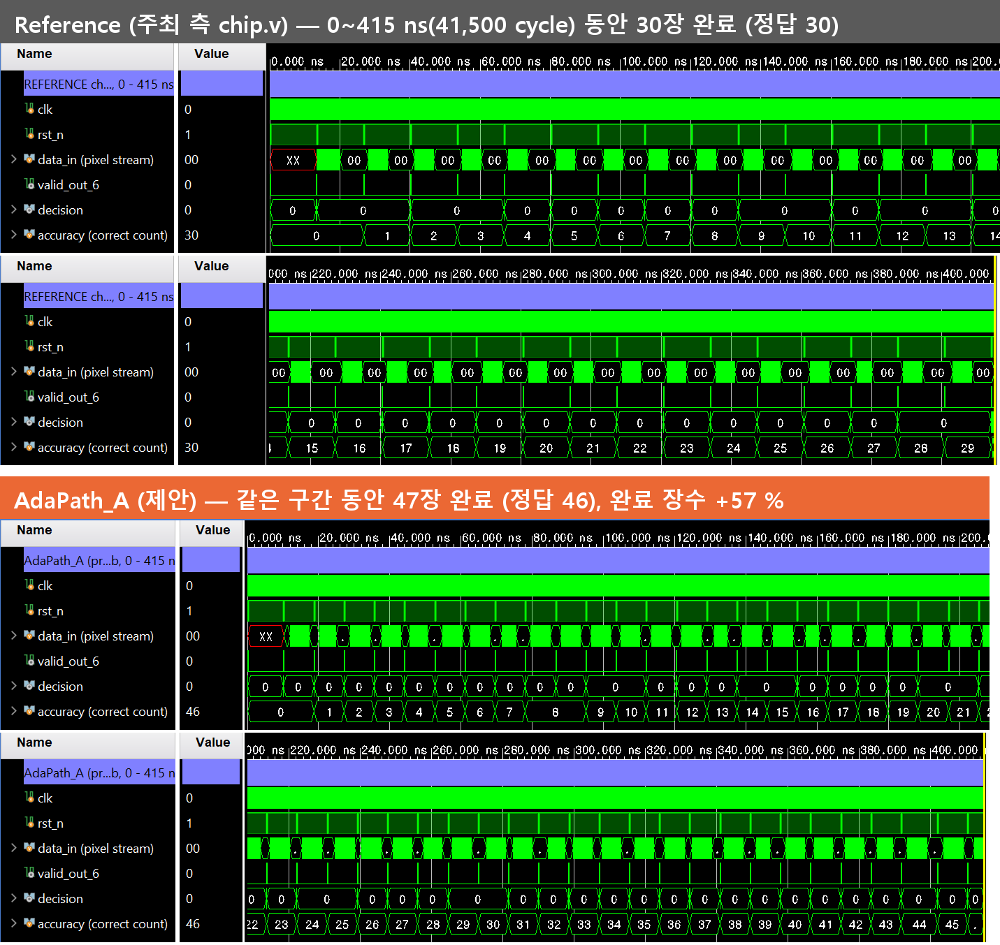

Hard 판정 이미지의 내부 처리 순서: 판정 → FSM BACK → 특징 버퍼 재생 → Conv2 전 채널 → Full FC → 출력

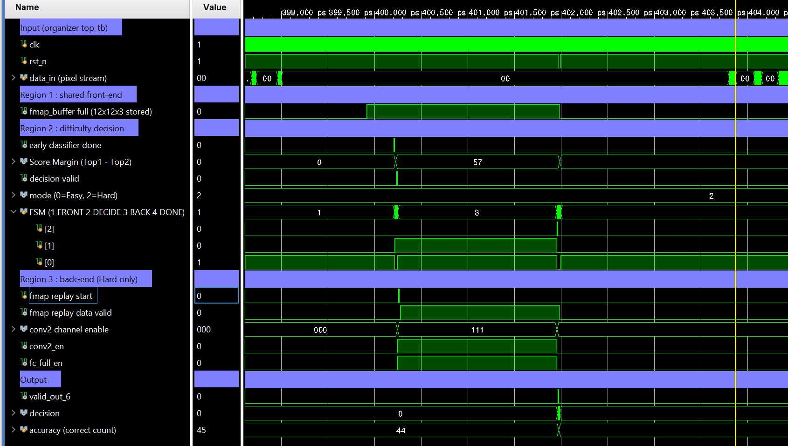

### 입력이 어려워지면 연산을 더 쓴다 (RTL 시뮬레이션, 열화 입력)
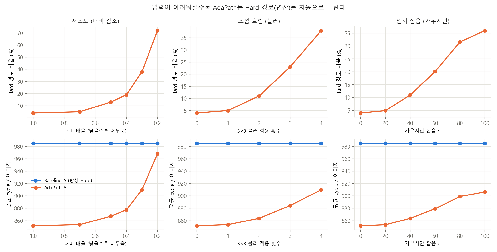

### 런타임 임계값 스윕 (실험용 RTL 시뮬레이션)
제출 설계 A의 임계값은 **63 / 63으로 고정**되어 있습니다. 런타임 변경 기능은 실험용 RTL의 기능입니다. 관측 입력에서는 TH = 0, 10, 20, 30이 980회 정답으로 더 유리했지만, 사후 탐색 결과를 새로운 입력의 성능으로 일반화하지 않고 제출 동작점을 유지했습니다.
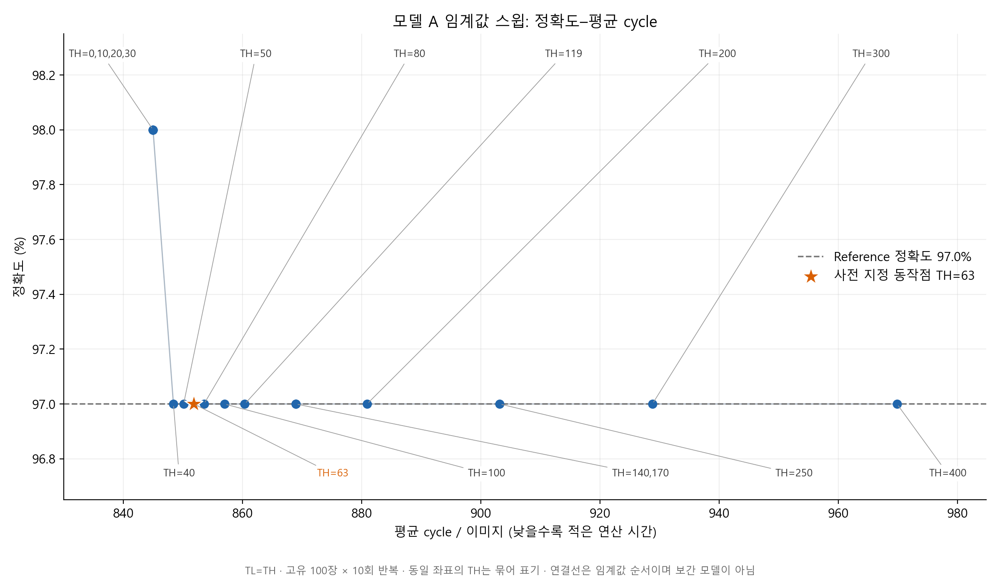

### 왜 Score Margin인가 — 난이도 지표 비교 (모델 A)
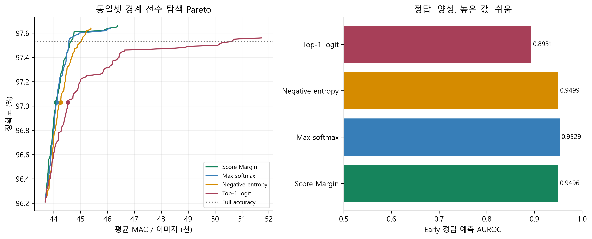

### Medium 경로의 기여 (Early-Exit vs AdaPath, WM-811K)
| Pareto 비교 | WM-811K 클래스별 경로 배분 |
|---|---|
| 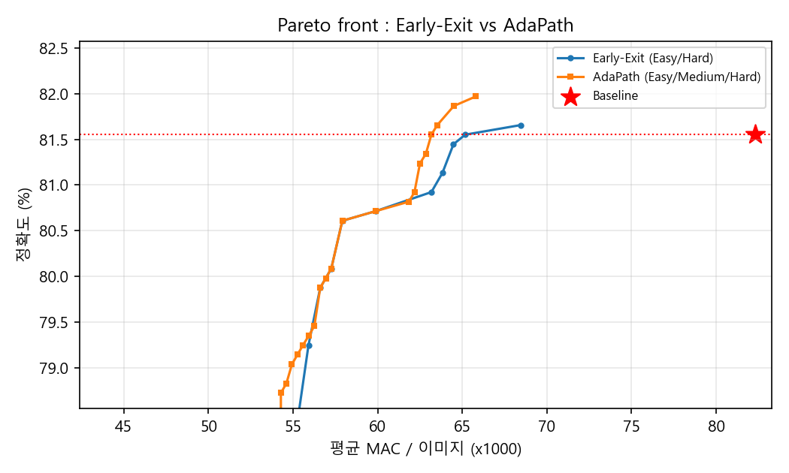 | 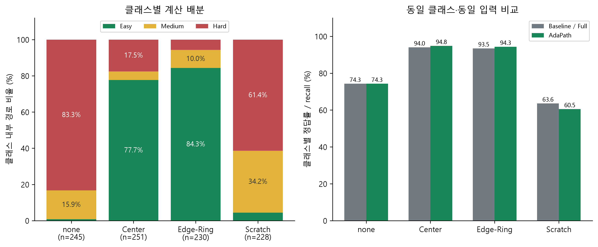 |

> 수치의 평가 조건(RTL 시뮬레이션 / Python float 분석 / VCD 기반 전력 추정 / pre-layout STA)과 한계는 최종 결과보고서 3~4장에 정리되어 있습니다.

합성 넷리스트 기능 검증은 **5개 시드의 부분 실행 합계에서 판정 1,007 / 1,007, 처리 cycle 1,006 / 1,006 일치**입니다. 원본 테스트벤치 한 번의 1,000회 실행 완료를 의미하지 않습니다(보고서 3.5.7절).

## 폴더 구조

| 경로 | 내용 |
|---|---|
| `python/` | 데이터 준비(`data_mnist.py`, `data_wm811k.py`), 학습(`train.py`), 임계값 탐색(`analyze_margin.py`), INT8 export(`export_int8.py`), Early-Exit 대비 분석(`iso_accuracy.py`), chip 래퍼 가중치 생성(`gen_chip_weights.py`) |
| `rtl/` | 파라미터화 RTL(`adapath_top.v` 외), 주최 측 인터페이스 래퍼(`chip_adapath.v`), 테스트벤치, `run_sim.sh` |
| `rtl/ref/` | 주최 측 레퍼런스 conv1/conv2 line buffer 발췌 (출처 표기, 원저작자: Bo Young Kang) |
| `rtl/verify/` | Top-2 Finder 개선 전·후 동일성 검증 TB |
| `orfs/` | ORFS 설계 설정(`asap7/`), 합성용 소스(`src/`), STA/전력 Tcl, 중간보고서 시점 리포트 |
| `orfs/designs_final/` | 최종 비교용 설계 설정(레퍼런스, 모델 A, WM-811K) |
| `flow_scripts/` | WSL에서 실행한 합성·STA·VCD 전력 스크립트 |
| `glsim/` | 게이트레벨 시뮬레이션 TB(AdaPath A/B, 레퍼런스)와 실행 스크립트 |
| `vivado/` | Vivado 2023.1 프로젝트 생성·시뮬레이션 Tcl (주최 측 top_tb.v 사용) |
| `out/` | 그림, 결과 표, 학습 가중치(`.pt`), RTL용 INT8 데이터(`rtl_data_*`) |
| `report/` | 최신 최종 PDF, 기존 Word 작업본 및 보고서 생성 스크립트 |
| `docs/` | 중간보고서 |

## 실행 요약

```bash
# 1) 학습 · 임계값 · INT8 (python/)
python data_mnist.py
python train.py --arch A --n_class 10 --prefix mnist
python analyze_margin.py --arch A --prefix mnist
python export_int8.py --arch A --prefix mnist --t_low 1.161 --t_high 1.161

# 2) RTL 시뮬레이션 (rtl/, Icarus Verilog)
bash run_sim.sh
```

## 저장소에 포함하지 않은 것

- 데이터셋 원본(MNIST, WM-811K `LSWMD.pkl`) — 공개 데이터, `python/data_*.py`로 재생성
- 주최 측 레퍼런스 RTL·데이터(`verilog_ref/`) — 대회 배포물
- 시뮬레이션 덤프(`.vcd`, `.vvp`)와 합성 넷리스트 — 용량이 크고 스크립트로 재생성 가능

## 추가 실험 1: 런타임 임계값 스윕 (실험용 RTL 동작 곡선)

`adapath_top`에 `USE_REG_TH` 파라미터와 `th_low_i` / `th_high_i` 포트가 추가되었다.
기본값(`USE_REG_TH=0`)에서는 기존과 동일하게 `thresholds.vh`의 고정 임계값을 쓴다
(기존 회귀 200/200, 27/27, 1,000장 결과 동일 확인).

```bash
# 주최측 input_1000.txt 를 verilog_ref/data/ 에 둔 뒤 (저장소 루트 기준)
cd rtl
bash run_sweep.sh A      # 모델 A: T_low = T_high 스윕 -> sweep_A.csv
bash run_sweep.sh B      # 모델 B: T_low=71 고정, T_high 스윕 -> sweep_B.csv
```

검증된 기준점 (이 값이 나오면 환경 설정이 맞는 것):

| 모델 | TL, TH | 정답 수 | 평균 cycle | Easy / Med / Hard |
|---|---|---|---|---|
| A | 63, 63 | 970 | 851.84 | 960 / 0 / 40 |
| B | 71, 119 | 1000 | 867.23 | 870 / 60 / 70 |

CSV로 "정확도 vs 평균 cycle" 곡선을 그리면 된다. 임계값 1회 실행에 약 1~2분이 걸린다.

## 추가 실험 2: 입력 난이도에 따른 연산 배분 (열화 강건성)

입력을 실제 센서 환경처럼 열화시켜 어려운 입력을 만들고, 모델 A의 AdaPath(임계값 63/63)와
Baseline(항상 Hard)을 비교한다. 입력이 어려워질수록 Hard 비율과 평균 cycle이 자동으로 늘어나는지
(난이도 비례 연산 배분), 정확도가 Baseline과 같게 유지되는지를 본다.

| 열화 | 의미 | 단계 |
|---|---|---|
| contrast | 저조도 / 노출 부족 (픽셀 × c) | 1.0, 0.7, 0.5, 0.4, 0.3, 0.2 |
| blur | 초점 흐림 (3×3 평균 n회) | 0 ~ 4 |
| gauss | 센서 잡음 (가우시안 σ) | 0, 20, 40, 60, 80, 100 |

```bash
# 주최측 input_1000.txt 를 verilog_ref/data/ 에 둔 뒤
cd python && python make_noisy_inputs.py        # rtl/noisy/ 에 17개 파일 (seed 고정)
cd ../rtl && bash run_robustness.sh 4           # 34회 시뮬레이션, 4개 병렬 -> rtl/robustness_A.csv
cd ../python && python plot_robustness.py       # -> out/fig_robustness_modes.png, fig_robustness_acc.png
```

검증된 기준점 (RTL 실측):

| 입력 | 설계 | 정답 | 평균 cycle | Easy / Med / Hard |
|---|---|---|---|---|
| contrast 1.0 (원본) | AdaPath | 970 | 851.84 | 960 / 0 / 40 |
| contrast 1.0 (원본) | Baseline | 970 | 985.00 | 0 / 0 / 1000 |
| contrast 0.3 | AdaPath | 930 | 909.98 | 620 / 0 / 380 |
| contrast 0.3 | Baseline | 930 | 985.00 | 0 / 0 / 1000 |

최종 보고서의 17조건 × 2설계 RTL 시뮬레이션에서는 대비 0.2의 정확도가 AdaPath 80.0 %, Baseline 76.0 %였습니다. 반면 강한 블러 4회에서는 87.0 % 대 90.0 %, 가우시안 잡음 σ = 100에서는 74.9 % 대 83.0 %로 AdaPath가 낮았습니다. 높은 Score Margin으로 오분류한 입력이 조기 종료되었을 가능성이 있으며, 원인을 확인하려면 오류 입력별 추가 분석이 필요합니다(보고서 3.10절).

`tb_threshold_sweep.v` 옵션: `-DMODEL_A`(모델 A), `-DBASELINE`(항상 Hard), `+IMG=<파일>`(입력 교체), `+TL= +TH=`(임계값).
주최측 input_1000.txt는 서로 다른 100장이 10번 반복된 구성이라, 결정적 열화(contrast, blur)의 결과는 10장 단위로 움직인다.

## 분석용 테스트 데이터 (data_test/)

`mnist_test.npz`(10,000장), `wm811k_test.npz`(954장, 4개 클래스 균형 추출)를 분석 재현용으로 포함한다.
`python/analyze_margin.py` 등은 `--out` 경로에서 `<prefix>_test.npz`와 `adapath_<prefix>_<arch>.pt`를 찾으므로,
`out/`에 복사하거나 `--out`으로 두 파일이 함께 있는 폴더를 지정한다.
