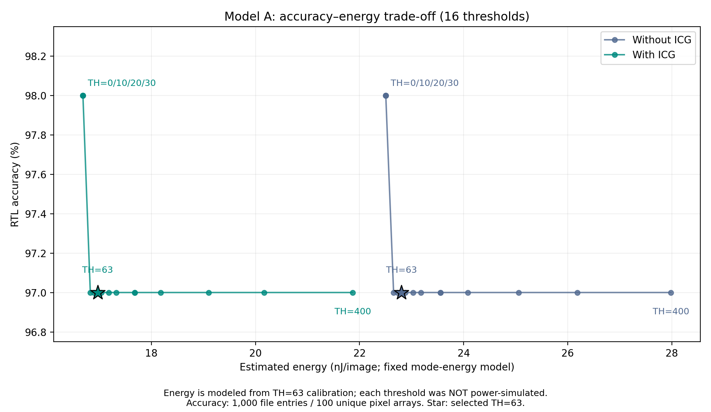

# 정확도–에너지 Pareto 분석: 모드 가중 추정

**결론:** 기존 RTL 임계값 스윕과 4번 전력 표본 확대 결과를 결합한 고정 모드 에너지 모델에서, TH=0·10·20·30이 각 설계 내 비지배점이다. TH=63은 이 입력에서 최적점이 아니다. 이 결과는 임계값별 전력을 직접 재측정한 결과가 아니며, 임계값 변경을 권고하는 일반화된 결론도 아니다.

## 방법 및 재현
`rtl/sweep_A.csv`의 16개 임계값에 대해 1,000개 입력의 정확도와 Easy/Hard 비율을 사용하였다. 모든 행은 TL=TH이고 Medium=0이다. 전력 표본 확대 commit `676aab3`에서 TH=63 조건의 Easy 36개 및 Hard 4개의 이미지당 평균 에너지를 가져왔다. 각 임계값에서 `E(TH) = p_Easy(TH) × E_Easy(63) + p_Hard(TH) × E_Hard(63)`으로 계산하였다. 게이팅 전후 모두 같은 입력 정확도를 적용한 것은 기존 TH=63 기능 일치 검증과 게이팅의 기능 보존을 전제로 한 모델이다. 다른 임계값의 게이팅 설계를 새로 시뮬레이션한 것은 아니다.

`python analyze.py`로 CSV·그림·출처 해시를 재생성한다(Python, matplotlib 필요). `provenance.json`은 입력 파일 SHA-256과 계산식을 기록한다. `pareto_model.csv`에는 32개 점의 반올림 전 에너지와 설계 내/설계 간 비지배 여부가 있다. 다른 점이 정확도 이상·에너지 이하이며 한 축에서 엄격히 우수할 때 지배한다고 정의하였다. 동일한 네 점은 모두 비지배로 유지하였다. Decimal 계산과 별도의 부동소수점 계산을 대조하였고, TH=63 에너지가 4번의 96:4 가중 결과와 일치함을 검증하였다.

| 임계값 | RTL 정답/1,000 | Easy/Hard | 미적용 추정 에너지(nJ/영상) | 적용 추정 에너지(nJ/영상) |
|---|---:|---:|---:|---:|
|0·10·20·30|980|1,000/0|22.503842|16.683687|
|63|970|960/40|22.804106|16.967759|

## 서현에게 넘길 문단 · 권장 위치
임계값 스윕 결과 다음, 클럭 게이팅 표본 확대 결과를 참조하는 절에 아래 문단을 추가한다. 보고서 원문은 수정하지 않았다.

임계값 선택에 따른 정확도–에너지 상충 관계를 살펴보기 위하여 RTL 스윕에서 얻은 모드 비율과 활동도 기반 모드별 에너지 추정치를 결합하였다. TH=63에서 평가한 Easy 36개 및 Hard 4개의 평균 에너지를 임계값에 대해 고정한 모델을 사용하였다. TH=0·10·20·30은 정확도 98.0%와 게이팅 적용 에너지 추정치 16.683687 nJ/영상으로 동일한 비지배점에 위치하였으며, 선정 동작점 TH=63은 정확도 97.0%와 16.967759 nJ/영상으로 나타났다. 따라서 본 평가 입력과 고정 모드 에너지 모델에서는 TH=63을 최적 임계값으로 해석할 수 없다. 다만 동일 평가 입력을 이용한 사후 임계값 선정은 독립 검증이 아니므로, 별도 검증 집합과 실제 임계값별 활동도 분석 없이 설계 동작점을 변경하지 않았다.

**그림 캡션:** 모델 A의 정확도–에너지 관계. 정확도는 1,000개 파일 입력에 대한 RTL 스윕 결과이며, 에너지는 TH=63의 모드별 활동도 기반 추정치에 각 임계값의 모드 비율을 가중한 모델값이다. 각 임계값의 전력을 직접 재측정하지 않았다. 별표는 선정값 TH=63, TH=0·10·20·30은 서로 겹치는 비지배점이다. 입력 파일은 고유 픽셀 배열 100개로 구성된다.

## 해석 범위와 필수 한계
- TH가 바뀌면 모드 내부의 입력 구성도 바뀐다. 낮은 TH에서는 기존 Hard 입력이 Easy로 이동하고, 높은 TH에서는 기존 Easy 입력이 Hard로 이동한다. 특히 TH=400의 Hard 730개를 TH=63의 고유 Hard 4개 평균으로 대표시키는 가정은 직접 검증되지 않았다. 모델 곡선은 이러한 입력별 활동도 차이를 포착하지 못한다.
- 별도 임계값별 게이트 수준 실행이나 합성을 수행하지 않았다. 임계값 변경에 따른 제어 회로 전력·게이팅 동작 차이도 고정 모드 모델에 포함되지 않는다.
- 4번과 동일한 ASAP7 RVT TT 0.7 V, 25°C, 100 MHz 조건이다. 배치·배선·실제 CTS·기생성분·SDF 글리치·다중 PVT를 포함하지 않은 전력 추정이다.
- 에너지는 4영상 구간의 reset/start를 포함한 관측 시간을 4로 나눈 기준이다. RTL 평균 cycle에 10 ns를 곱한 시간과 정확히 동일하지 않다. 이 차이를 숨기거나 둘을 혼용하지 않는다.
- 1,000개 파일 행은 100개 고유 픽셀 배열의 반복이다. 전체 MNIST 또는 hidden test의 Pareto 최적성, 통계적 유의성, 에너지 오차범위를 주장하지 않는다.
- 게이팅 전후를 함께 고려한 비지배점은 모델상 gated TH=0·10·20·30이다. 이는 에너지 모델과 기능 보존 가정하의 비교이며 새로운 임계값 검증을 대체하지 않는다.
