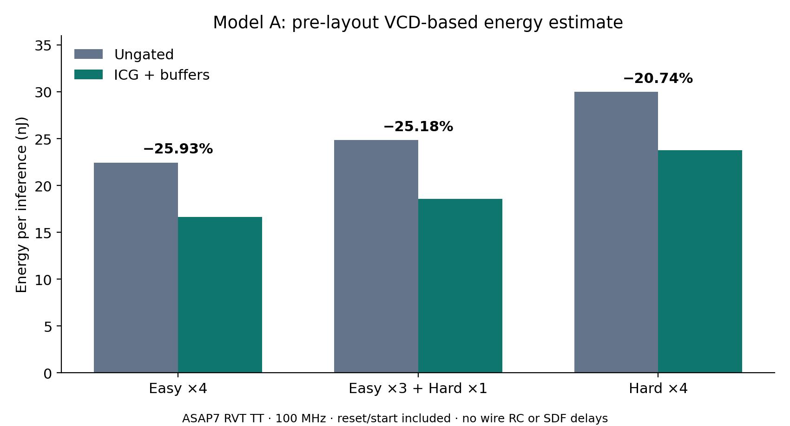

# 클럭 게이팅 전후 배치 전 전력 재평가

**완료: 모델 A, 전용 ASAP7 ICG 및 클럭 버퍼를 포함한 동일 조건 비교.** 선정한 세 구간에서 전력·에너지 추정값이 20.743~25.926% 감소하였다. 실리콘 실측 및 전체 데이터셋 평균을 의미하지 않는다. 원본 RTL·제출 ZIP·보고서는 수정하지 않았다.

## 결과

| 구간 | 기준 전력 (mW) | ICG 전력 (mW) | 기준 에너지 (nJ/장) | ICG 에너지 (nJ/장) | 감소율 (%) |
|---|---:|---:|---:|---:|---:|
| Easy 4장 | 2.616231 | 1.937954 | 22.444645 | 16.625705 | 25.926 |
| Easy 3장 + Hard 1장 | 2.758922 | 2.064295 | 24.848229 | 18.592076 | 25.177 |
| Hard 4장 | 2.916748 | 2.311740 | 30.010420 | 23.785489 | 20.743 |

각 구간의 VCD 관측 시간은 Easy 34.316 µs, 혼합 36.026 µs, Hard 41.156 µs이다. 각 4회 추론의 reset·start 시간을 포함한다. 에너지=평균 전력×관측 시간÷4이며, 두 설계의 관측 시간이 같아 전력·에너지 감소율이 동일하다. 세 구간은 12회 실행·11개 고유 입력이다.

## 검증 근거

- 실제 ICG 셀은 `ICGx1_ASAP7_75t_R`이다. 기능 RTL 1,000회 대조는 두 설계 모두 970/1,000, 평균 851.84 cycle, E/M/H=960/0/40, 출력·cycle 불일치 0건이었다. [집계](icg_rtl_full_validation.json).
- 최종 버퍼 넷리스트 6개 구간(각 4회, 총 24회)의 decision·mode·margin·cycle이 모두 기준 RTL과 일치하였다. Hard 구간의 2개 오분류도 동일하다. [게이트 수준 대조](power_results/gatelevel_validation.json).
- 모든 전력 런의 VCD 활동도 미적용 핀 수는 0이다. 기준/게이팅 설계의 주석 핀은 각각 1,103,316/1,098,421개이다. 전체 핀 수의 차이는 별도 합성 결과의 차이이며 주석 누락이 아니다.
- 10 ns에서 최소 setup slack: 기준 +6.233199 ns, 게이팅 +6.224182 ns. 최소 hold slack: +37.778517 ps/+35.425427 ps. 해당 모델에서 보고된 전기적 제약 위반은 없었다. 물리적 CTS·배선 이후 signoff는 수행하지 않았다.
- 초기 단일 ICG의 부하·slew 위반과 중간 직렬 클럭 트리의 hold 위반을 숨기지 않고 [제외한 진단 로그](power_results/diagnostics/)에 보관하였다. 최종 구조는 ICG 뒤 후단 트리와 전단 트리를 분리하였다. 전력 계산 첫 시도의 선택적 인스턴스 순위 출력 명령은 도구 미지원으로 실패하여 제거한 뒤 전체 6개 런을 다시 실행하였다.

## 비교 조건과 해석 한계

Yosys 0.58, OpenROAD 26Q2-1164-g08f67ee5ec, Icarus 12.0, ORFS 7bf5a814e47c54ec6c64692b464d398184d99891. ASAP7 RVT TT, 0.7 V/25°C 라이브러리, 평가 클럭 100 MHz. 합성 목표 주기 1 ns와 평가 주기 10 ns를 구분한다. 가중치는 합성 top의 입력 포트이며 TB에서 구동한다.

기준/게이팅 설계에 BUFx2 및 최대 분기 수 4의 결정론적 클럭 버퍼 트리를 적용하였다. 추가 버퍼 수는 4,273/4,279개이며, ICG는 게이팅 설계에 1개이다. 합성 면적은 38,393.557740/38,297.417220 µm²이고 버퍼 1개의 라이브러리 면적은 0.0729 µm²이다. 버퍼 포함 면적은 38,705.059440/38,609.356320 µm²이다. 작은 면적 감소는 별도 합성·매핑 차이를 포함하므로 ICG 자체의 면적 절감으로 해석하지 않는다.

이 비교는 클럭 버퍼의 셀 부하·지연·전력은 포함하지만 배치 좌표, 배선 RC, 실제 CTS 최적화, 다중 PVT 및 지연 기반 글리치 전력을 제외한 배치 전 모델이다. 무지연 VCD와 라이브러리 기반 STA는 SDF 시뮬레이션이 아니다. Hard에서도 비활성 시점이 존재하지만 별도 합성 매핑 차이까지 포함된 설계 쌍의 비교이므로 감소분 전체를 게이트 하나의 순수 인과 효과로 분리하지 않는다.

이번 input_1000.txt는 100개 고유 픽셀 배열의 10회 반복이다. 1,000회 기능 실행과 독립 이미지 1,000개 검증을 혼동하지 않는다. 기존 Reference를 같은 환경에서 재실행하지 않았으므로 Reference 대비 새 개선율이나 기존 28.7% 추정의 검증률을 제시하지 않는다. 관련 한계는 [프로토콜](POWER_PROTOCOL.md)에 상세히 기록하였다.

## 수치 검산

JSON의 Total과 텍스트 Total이 완전히 일치하는지 확인하고, 내부·스위칭·누설 전력 합과 에너지 산식을 검사하였다. OpenSTA는 전체와 셀 그룹을 각각 누적하므로 그룹 합과 전체 Total 사이에 작은 차이가 관찰되었다. 이 차이를 요약 JSON의 `category_sum_residual_percent`로 보존하며 0.01% 미만을 확인하였다. 비교 계산은 일관되게 도구의 Total을 사용하였다. 이 잔차를 측정 불확실성이나 통계적 신뢰구간으로 해석하지 않는다.

## 전달 및 재현 자료

- [서현 전달 문단·권장 위치·캡션](HANDOFF.md)
- [검산된 요약 JSON](power_results/summary.json), [원시 전력·시뮬레이션 로그](power_results/logs/), [합성 로그](power_results/synthesis/)
- [도구·입력·라이브러리 해시](environment.json), [합성 소스 해시](power_source_manifest.json), [표준셀 기능 모델 변환 해시](power_results/cell_model_manifest.json)
- [최종 기준 넷리스트](power_results/ungated.v.gz), [최종 ICG 넷리스트](power_results/gated.v.gz), [대용량 원본 해시·보관 경로](power_results/raw_artifact_manifest.json)
- [실행 재현 안내](REPRODUCE_POWER.md), [이전 RTL 검증 기록](RTL_HISTORY.md)

원시 VCD와 ODB는 용량 때문에 Git에 넣지 않았다. 이 PC의 Ubuntu-24.04 `/root/ppa-clockgate-buffered/`(VCD), `/root/ppa-clockgate/buffered_v2/`(최종 ODB)에 보관하며 SHA-256을 공개하였다. 입력 파일은 원래의 배포·공유 경로에서 별도 준비해야 한다. GitHub만으로 원시 VCD를 바로 다운로드할 수 있는 구성은 아니며, 포함된 넷리스트와 명령으로 재생성할 수 있다.
