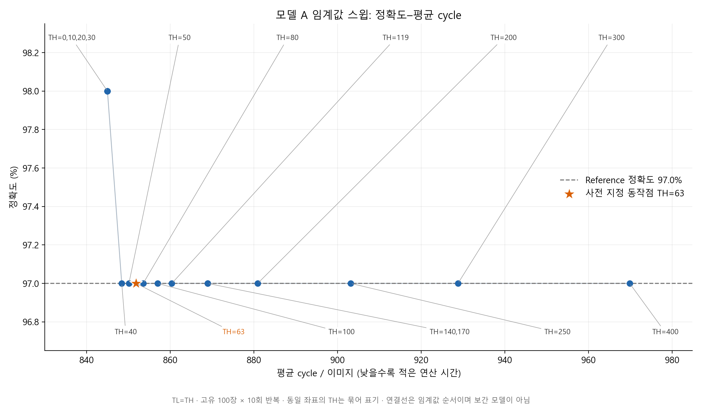

# 실험 1: 모델 A 임계값에 따른 정확도–연산 시간 절충

## 연구 질문
Score Margin 임계값을 변화시켰을 때 모델 A의 분류 정확도와 이미지당 평균 사이클 및 경로 분포가 어떻게 변화하는지 평가하였다.

## 실험 방법
- 코드 커밋 `5b9d9d2ce36e86ef7d3a3dfd46eac903435a209f`과 `out/rtl_data_mnist_A/` 가중치를 사용하였으며 기존 RTL .v 파일은 수정하지 않았다.
- 공식 입력 1,000장에 대해 TL=TH를 0, 10, 20, 30, 40, 50, 63, 80, 100, 119, 140, 170, 200, 250, 300, 400으로 설정하였다. 원본 `run_sweep.sh A`와 동일한 컴파일 옵션·테스트벤치·입력을 사용하고 Windows Python 실행기로 순서만 변경하여 TH=63 검증 후 4개 병렬로 실행하였다.
- TH=63의 필수 기준값을 먼저 검사하였고, 각 실행의 정상 출력 1,000/1,000, 모드 합 1,000, TL=TH에서 Medium=0 및 16조건 누락·중복 없음을 검증하였다.
- 입력은 고유 100장의 10회 반복으로 독립 표본 1,000장이 아니며, 테스트벤치가 정의한 start 이후 valid_out까지의 cycle을 평균하였다. 파형 기반 전력·실측 지연 또는 MAC 수를 측정한 실험은 아니다.

## 결과 표
| TL=TH | 정답/1000 | 정확도 (%) | 평균 cycle | Easy | Medium | Hard |
|---:|---:|---:|---:|---:|---:|---:|
| 0 | 980 | 98.0 | 845.00 | 1000 | 0 | 0 |
| 10 | 980 | 98.0 | 845.00 | 1000 | 0 | 0 |
| 20 | 980 | 98.0 | 845.00 | 1000 | 0 | 0 |
| 30 | 980 | 98.0 | 845.00 | 1000 | 0 | 0 |
| 40 | 970 | 97.0 | 848.42 | 980 | 0 | 20 |
| 50 | 970 | 97.0 | 850.13 | 970 | 0 | 30 |
| 63 | 970 | 97.0 | 851.84 | 960 | 0 | 40 |
| 80 | 970 | 97.0 | 853.55 | 950 | 0 | 50 |
| 100 | 970 | 97.0 | 856.97 | 930 | 0 | 70 |
| 119 | 970 | 97.0 | 860.39 | 910 | 0 | 90 |
| 140 | 970 | 97.0 | 868.94 | 860 | 0 | 140 |
| 170 | 970 | 97.0 | 868.94 | 860 | 0 | 140 |
| 200 | 970 | 97.0 | 880.91 | 790 | 0 | 210 |
| 250 | 970 | 97.0 | 903.14 | 660 | 0 | 340 |
| 300 | 970 | 97.0 | 928.79 | 510 | 0 | 490 |
| 400 | 970 | 97.0 | 969.83 | 270 | 0 | 730 |

## 그래프 해석
TH=63에서 정답 970개, 정확도 97.0%, 평균 851.84 cycle, Easy/Medium/Hard=960/0/40을 재현하였다. 스윕 구간의 정확도는 97.0–98.0%였으며, 평균 사이클 범위는 845.00–969.83 cycle로 측정되었다. TH=0과 TH=400의 Hard 개수는 각각 0개와 730개였으며, 임계값 증가에 따른 경로 선택 변화가 관측되었다. 측정한 정확도–사이클 조합에서 비지배 동작점은 TH=0, 10, 20, 30에 해당하였으며, TH=63은 다른 측정 동작점에 의해 지배되었다. 이는 이 입력 집합과 스윕 범위에 한정한 비교이며, 새로운 입력에서의 최적 임계값이나 일반화 성능을 확정하지 않았다.

그림 1. 모델 A에서 TL=TH를 변화시킨 정확도–평균 사이클 관계. 각 점의 TH를 표기하고 TH=63을 강조하였으며, 97.0% Reference 정확도를 점선으로 나타내었다. 동일 좌표의 임계값은 묶어서 표기하였다. Malgun Gothic, PNG 200 dpi이며 편집용 SVG를 함께 제공하였다.

## 한계 및 연구 해석
- 사전 지정점 대비 가장 빠른 측정점(TH=0)의 정확도 차이는 +1.0%p, 평균 사이클 차이는 -6.84 cycle이었다. 경로 적응 기능의 동작과 성능상의 이득을 구분하였으며, 원본 입력에서 TH=63이 더 우수하다고 주장하지 않았다.
- 비지배점은 정확도를 최대화하고 사이클을 최소화하는 두 목적에 대해 다른 측정점이 두 지표 모두 나쁘지 않으면서 하나 이상 더 좋은 경우를 제외하여 계산하였다. 같은 좌표를 갖는 TH는 동등한 측정점으로 유지하였다.
- 동일 입력 집합에서 임계값을 탐색하고 성능을 보고하였으므로, 사후 선택 동작점의 성능을 독립 테스트 결과로 해석하지 않았다. 일반화 주장에는 별도 validation/test 분리와 더 다양한 입력이 필요하다.
- Score Margin은 확률로 보정된 신뢰도가 아니다. Hard 경로 증가가 개별 입력의 정답을 보장하지 않으며 정확도는 임계값에 대해 단조 증가할 필요가 없다.
- TL=TH이므로 Medium 구간은 비어 있다. 본 결과로 3경로 설계의 이득이나 entropy 대비 우월성, 통계적 유의성을 입증하지 않았다.
- 그래프의 Reference 97.0%는 요청된 비교 기준선이다. 새로운 Reference 하드웨어 측정을 수행한 것으로 표시하지 않았다.

## 재현성 및 수행 시간
- 시작: 2026-10-30T01:51:40.964339+09:00; 완료: 2026-10-30T02:06:07.199747+09:00.
- 기준점 검증과 나머지 15조건을 포함한 실제 시뮬레이션 경과 시간은 약 14.4분이었다. 분석·게시 시간은 여기에 포함하지 않았다.
- 착수 시 예상: 시뮬레이션·분석·그림 검토·게시 포함 40–70분. 예상과 실제를 구분하였다.
- [원시 CSV](../rtl/sweep_A.csv), [실행별 로그 및 시간](exp1_artifacts/run_evidence.json), [입력·RTL·가중치 SHA-256](exp1_artifacts/manifest.json), [실행기](exp1_artifacts/run_sweep_a.py), [분석·그림 생성기](exp1_artifacts/analyze_sweep_a.py). 실행기와 분석기는 실제 실행 이력이며 원래 work/outputs 디렉터리 배치를 전제로 한다. 이 artifacts 폴더에서 그대로 실행하는 용도는 아니다.
- 재실행은 명시된 실험 커밋의 별도 체크아웃에서 공식 입력을 배치한 뒤 `cd rtl` 및 `bash run_sweep.sh A`를 사용한다. 입력 파일은 저장소에 추가하지 않았다. Python 실행기의 스윕은 같은 결과를 얻도록 원본과 동일한 16개 임계값과 컴파일 인수를 사용하였다.
- Python 3.12.14, Icarus Verilog 12.0(devel), Matplotlib 3.10.8을 사용하였다. 기존 실험 2와 동일한 로컬 환경에서 수행하였다.
- 실험 1의 모델 A 결과만 포함하였다. 선택 항목인 모델 B 및 실험 3의 완료를 의미하지 않는다.
