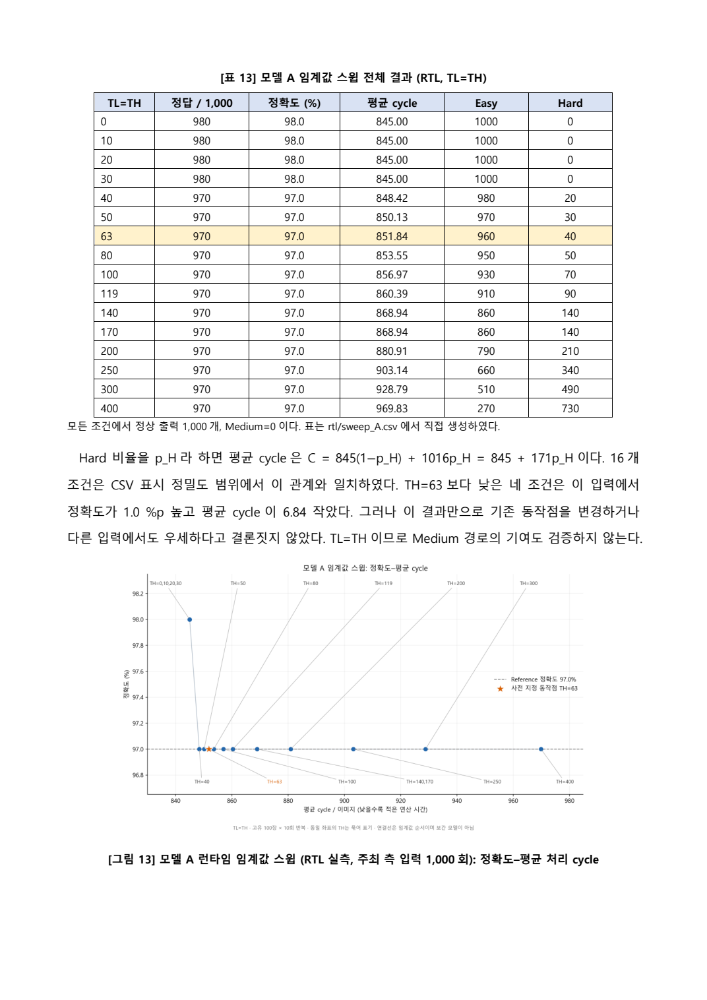
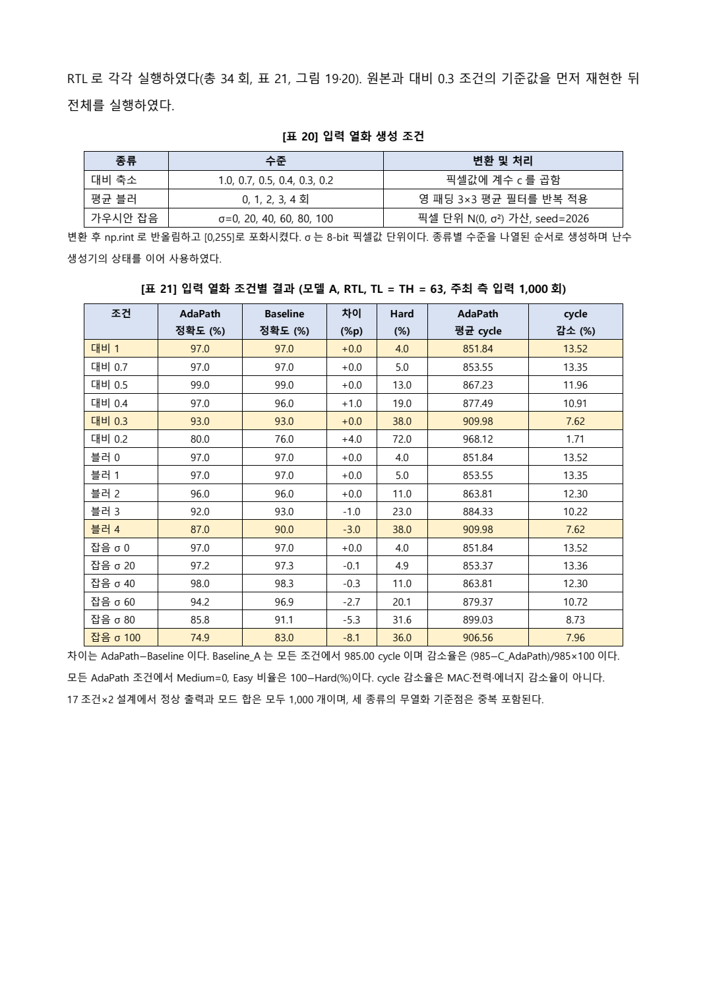
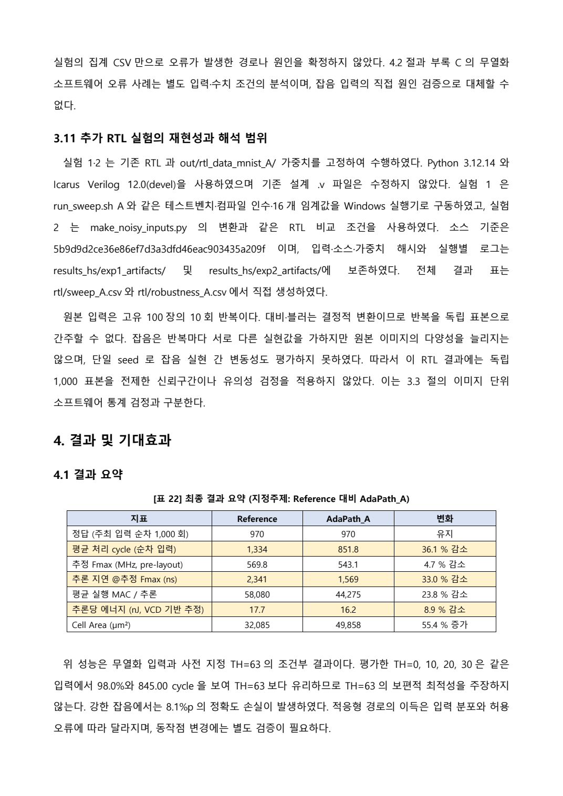
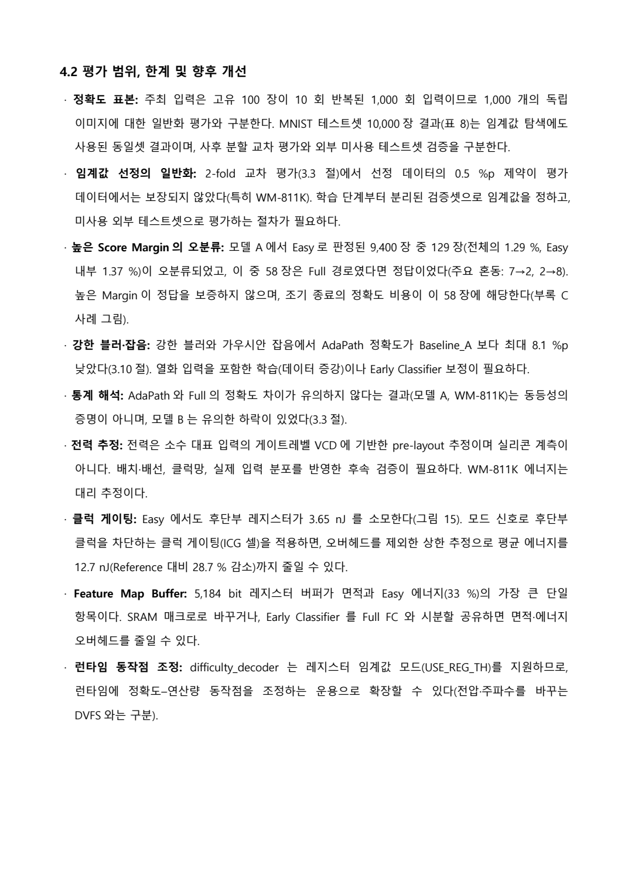
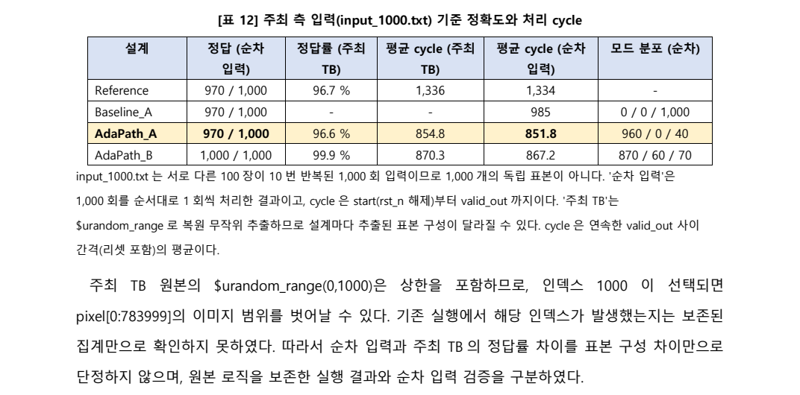
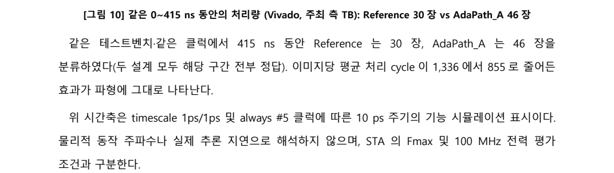
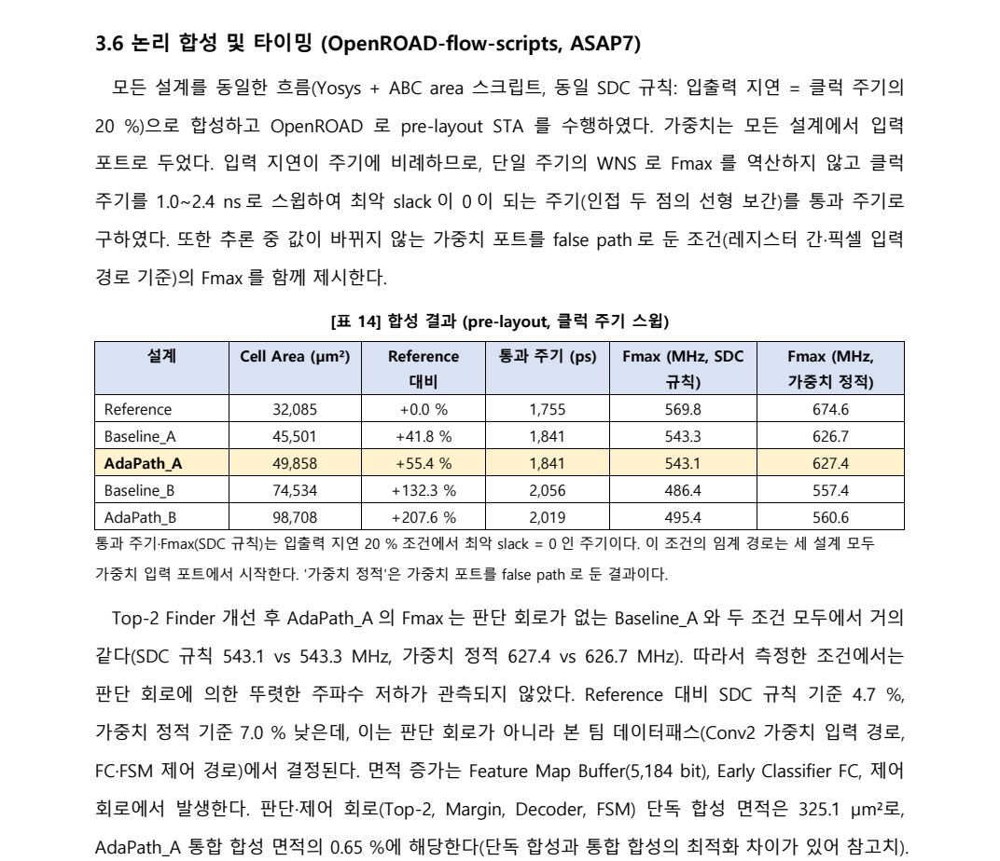
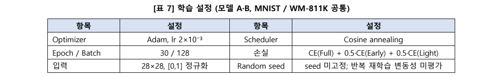
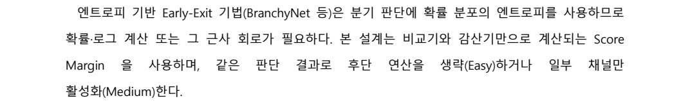

# 별도 수정 TB 재검증 반영본

최신본은 32쪽, 그림 23개, 표 29개이다. 직전 99f7f72 보고서의 표 28개와 그림 23개를 모두 보존하고, 13~14쪽에 수정 TB 방법·결과표·검증 범위를 추가하였다. 원본 TB·RTL·입력·가중치는 변경하지 않았다. 원본 TB 문제를 보존한 진단과 수정 TB의 정상 결과를 구분하였다.

수정 TB의 순차 입력은 970/1,000, Easy/Medium/Hard=960/0/40을 재현하였다. 고정 seed 무작위 입력은 971/1,000, 956/0/44이며 같은 인덱스의 순차 판정·모드와 모두 일치하였다. 양쪽 모두 출력 1,000, 범위 밖 읽기 0, X 데이터·출력 0, 픽셀 읽기 784,000, 타임아웃 0이었다. 원시 로그·CSV·실행 방법·해시는 results_hs/corrected_tb/에 있다.

최신 변경 화면은 report/corrected_tb_review_captures/에 있다. 아래는 직전 보완 이력이며 아래 표의 쪽수와 submission_review_captures 이미지는 해당 이전 버전의 기록이다.

---

# 제출 전 검증 반영본 (32쪽)

기존 28쪽 통합본을 기준으로 보완하였다. PDF 32쪽, 그림 23개, 표 28개이다. 기존 그림 22개와 제목 22개를 모두 보존하였고, 기존 표 25개 중 24개는 동일하며 나머지 하나는 Fmax 표의 열 제목만 정정하였다. 실험 1의 16행과 실험 2의 17조건을 원본 CSV와 대조하였다. 검증 상세는 report_integration_validation.json에 기록하였다.

| PDF 위치 | 이번 추가·정정 |
|---|---|
| 2쪽 | 자동 목차 및 전체 쪽수 표시 |
| 4쪽 | 성능 이득, 면적 비용, 강한 잡음 한계 요약 |
| 13쪽 | 원본 주최 TB의 범위 밖 읽기·X·출력 집계 진단 결과 |
| 17~18쪽 | 보간 Fmax와 실제 STA 통과점 구분 및 실패·통과 slack 표 |
| 22~23쪽 | Medium 9개 사례 재실행, 513 cycle 검사 및 실제 VCD 시각화 |
| 32쪽 | 전력 리포트 원시 수치, 측정 창, 에너지 환산 및 증거의 한계 |

변경 화면은 report/submission_review_captures/에 저장하였다. 원본 주최 TB와 설계 RTL은 수정하지 않았다. 원본 TB 진단은 Icarus 기본 난수 실행이며 기존 Vivado 난수열의 재현이 아니다. 원본 TB에서 정상적인 독립 1,000회 평가가 확보되었다고 주장하지 않는다. 별도 순차 입력 실험의 970/1,000과 구분한다. A 전력 측정 창은 보존된 에너지와 평균 전력의 역산값이며 독립적인 원본 VCD 시간 확인으로 주장하지 않는다.

아래는 직전 28쪽 통합 시점의 이력이다. 아래 쪽수와 report/review_captures/의 이미지는 이전 버전에 해당한다.

---

# 팀 통합본 기준 보고서 보완 기록

이 문서는 이전 23쪽 보완본의 통합 기록을 대체한다. 기준은 팀원 26쪽 보고서 커밋 `c3cbfacfef43c58113993181b7611332ae8eb254`이다. 해당 팀 통합 커밋을 exp-hyunseo에 병합하고 보고서만 보완하였다. main에 대한 쓰기 작업은 수행하지 않았다.

## 결과와 보존 확인

최종 PDF는 28쪽, DOCX에는 그림 22개·표 25개가 있다. 팀원 보고서의 제목 21개를 모두 유지하였다. 이미지 22개는 DOCX 내부 이미지의 SHA-256을 비교하여 전부 동일함을 확인하였다. 팀원 표 23개 중 21개는 모든 셀 값이 동일하며, 원본 표 7의 학습 seed 설명 한 셀을 정정하고 원본 표 19의 열화 5조건 요약을 17조건 전체 비교로 확장하였다. 실험 1 전체 표와 열화 생성 조건 표를 새로 추가하였다.

팀원 교차 평가, 통계 검정, 난이도 지표 비교, 블록별 에너지, WM-811K 클래스별 결과, 관련 연구, 재현성 부록 및 오류 사례는 보존하였다. Fmax 569.8/543.1 MHz 및 지연 2,341/1,569 ns는 팀원 클럭 스윕 결과를 유지하였다. 이전 23쪽 버전의 623.4/597.7 MHz 환산 값을 가져오지 않았다.

## 추가·수정·보완 위치

| 최종 PDF 위치 | 구분 | 변경 내용 |
|---|---|---|
| 2쪽 | 표현 정정 | 모든 Early-Exit가 엔트로피를 사용하는 것처럼 읽히지 않도록 엔트로피 기반 기법으로 범위를 한정 |
| 8~9쪽 | 표현 정정 | 반복 재학습 ±0.1%p의 미검증 주장을 제거하고 미평가로 명시; Medium 미선택은 평가 후보 내 선택으로 한정 |
| 12쪽 | 검증 한계 추가 | 주최 TB 난수 상한 1000의 배열 경계 문제와 실제 발생 여부 미확인을 명시; 차이 원인 단정 완화 |
| 13쪽 | 조건 구분 추가 | Vivado 10 ps 기능 클럭 시간축과 물리적 Fmax·100 MHz 전력 조건 구분 |
| 14~15쪽 | 실험 1 보완 | 정확히 평가한 TH=0,10,20,30 명시; 16조건 전체 표; 평균 cycle 식; TH=63의 최적성·일반화 한계 |
| 16쪽 | 표현 정정 | 543.1과 543.3 MHz 등을 동일하다고 단정하지 않고 거의 같다고 기술; 최신 팀원 스윕 수치 보존 |
| 22쪽 | 실험 2 확장 | 열화 생성 방법·수준·seed, 17조건의 두 설계 정확도·차이·Hard 비율·cycle·감소율 |
| 23~24쪽 | 해석 보완 | 7.96% cycle 이득과 8.1%p 정확도 손실 병기; 잡음 원인 가설과 무열화 오류 사례의 증거 범위 구분 |
| 24쪽 | 재현성·결론 추가 | 소스·입력·가중치·로그 경로, 반복 입력·단일 seed 한계, 사전 동작점 조건부 결과 |
| 25쪽 | 평가 범위 정정 | 동일 테스트셋 결과·사후 교차 평가·외부 미사용 테스트셋 검증 구분; 팀원 한계 항목 전부 보존 |

## 검증

- `python report/make_final_report.py`로 생성하였다. `python-docx`가 필요하다. 커밋되지 않은 그림 복사본 대신 저장소의 원본 그림을 직접 참조하도록 생성기를 수정하였다.
- `report/experiment_sections.py`는 CSV의 조건 수·모드 합·평균 cycle 관계 및 필수 기준값을 검사한다. 이전 23쪽 보고서를 추가하는 함수는 제거하였다.
- DOCX 실험 1 표 16행과 실험 2 표 17행을 CSV에서 별도로 계산하여 전수 대조하였다. 기존 팀원 수치표 21개를 셀 단위로 비교하였다.
- 제목·그림·표 번호, 미치환 참조, PDF 핵심 수치를 검사하였다. 보존 수치와 해시는 `report_integration_validation.json`에 기록하였다.
- Microsoft Word ExportAsFixedFormat으로 PDF를 생성하고 28쪽 전부를 렌더링하여 확인하였다. 마지막 수정 후에는 바뀐 12쪽을 다시 확인하고 나머지 페이지의 렌더 이미지 해시가 동일함을 확인하였다.
- 새 시뮬레이션, 학습, 전력 측정은 수행하지 않았다. 팀원 기존 분석은 보존·대조하였으며 모든 실험을 재실행한 것은 아니다. 주최 TB 경계 문제의 실제 발생 여부 및 단일 seed·사후 교차 평가 등의 한계는 본문에 남겼다.

## 변경 부분 캡처

아래 이미지는 최종 PDF에서 직접 렌더링한 페이지 또는 해당 부분이다.

### 01_실험1_전체결과

### 02_실험2_전체결과

### 03_재현성_결론

### 04_평가한계

### 05_주최TB_경계

### 06_시간축_구분

### 07_최신Fmax_유지

### 08_학습seed_정정

### 09_임계값_선정범위

### 10_서론_표현정정

